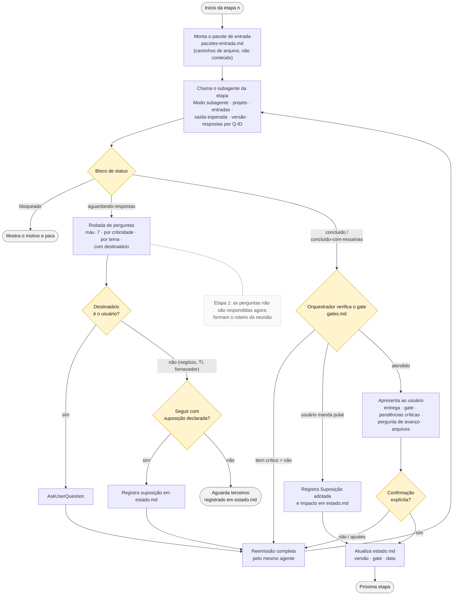
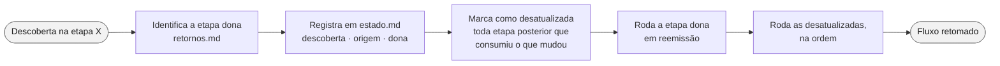

# Fluxograma — Fluxo de Produto

Fluxo da TAP ao Documento de especificação ADS, conduzido pelo orquestrador `fluxo-produto`.
Fonte: [skills/fluxo-produto/SKILL.md](../skills/fluxo-produto/SKILL.md) e referências
(`gates.md`, `retornos.md`, `estado.md`, `pacotes-entrada.md`).

## 1. Visão macro

Etapas, gates, entregas e retornos. Setas tracejadas são retornos à etapa dona da informação
(detalhe em [retornos.md](../skills/fluxo-produto/references/retornos.md)).

```mermaid
flowchart TD
    INICIO(["Pedido do usuário"]) --> EST{"estado.md existe?"}
    EST -->|sim| RET["Retomada: informa onde o projeto está<br/>e o que falta para o próximo gate"]
    RET --> CONT{"Continua dali?"}
    CONT -->|sim| E1
    EST -->|não| AB["Abertura do projeto<br/>nome · área e ponto focal · tipo · local"]
    AB --> TAP{"TAP/RAP anexada?"}
    TAP -->|não| PEDE(["Pede o documento e para"])
    TAP -->|sim| CRIA["Cria fluxo/&lt;projeto&gt;/estado.md"]
    CRIA --> E1

    E1["1 · Entendimento da TAP<br/>agente-entendimento-tap"] --> A1["fontes/ (TAP e anexos)<br/>01-contexto-projeto.md v0.x<br/>01-benchmark.md<br/>01-roteiro-reuniao.md"]
    A1 --> G1{"Gate 1<br/>contexto completo, benchmark,<br/>perguntas Q- com destinatário"}
    G1 -->|não atendido| E1
    G1 -->|atendido + confirmação| REU[["Reunião de entendimento<br/>com negócio e TI"]]

    REU --> TR["Transcrição da reunião"]
    TR --> E2["2 · Reunião de entendimento<br/>agente-reuniao-entendimento"]
    E2 --> A2["02-ata-reuniao.md<br/>01-contexto-projeto.md v1.0<br/>02-prontidao-prototipo.md"]
    A2 --> G2{"Gate 2<br/>escopo confirmado,<br/>prontidão para protótipo OK"}
    G2 -->|não atendido| E2
    G2 -->|atendido + confirmação| E3

    E3["3 · Protótipo<br/>agente-prototipo"] --> A3["prototipo/ · 03-mapa-telas.md<br/>03-capturas/ · design-system.md"]
    A3 --> FIG{"Conector do Figma<br/>disponível?"}
    FIG -->|sim| FE["Envio ao Figma na sessão principal<br/>link no mapa de telas e no estado.md"]
    FIG -->|não| FP["Avisa em uma linha<br/>pendência declarada (não bloqueia)"]
    FE --> VAL["Validação com negócio<br/>03-validacao-prototipo.md"]
    FP --> VAL
    VAL --> G3{"Gate 3<br/>telas com TL-ID e origem,<br/>build e capturas OK, validação registrada"}
    G3 -->|não atendido| E3
    G3 -->|atendido + confirmação| E4

    E4["4 · Requisitos<br/>agente-requisitos"] --> A4["04-requisitos.md<br/>RN · RF por tela · RNF · RT<br/>técnicos · CT"]
    A4 --> G4{"Gate 4<br/>RF OK com CT,<br/>RF não OK em pendência"}
    G4 -->|não atendido| E4
    G4 -->|atendido + confirmação| E5

    E5["5 · Documentação<br/>agente-documentacao"] --> A5["05-especificacao-&lt;projeto&gt;.docx<br/>modelo ADS"]
    A5 --> G5{"Gate 5<br/>modelo preservado, sem seção inventada,<br/>pendências visíveis"}
    G5 -->|não atendido| E5
    G5 -->|atendido| FIM(["Especificação entregue"])

    VAL -.->|"regra nova ou mudança de escopo"| E2
    E4 -.->|"campo, estado ou ação de tela não definidos"| E3
    E4 -.->|"mudança de escopo, ator, perfil ou regra"| E2
    E5 -.->|"inconsistência de ID ou valor"| E4
    E2 -.->|"documento novo, nova versão da TAP<br/>ou solução de mercado viável"| E1

    classDef etapa fill:#1f4e79,stroke:#1f4e79,color:#fff
    classDef artefato fill:#eef3f8,stroke:#7a9cc0,color:#1a1a1a
    classDef gate fill:#fff4ce,stroke:#c9a400,color:#1a1a1a
    classDef externo fill:#e8f5e9,stroke:#4caf50,color:#1a1a1a
    classDef terminal fill:#f2f2f2,stroke:#888,color:#1a1a1a

    class E1,E2,E3,E4,E5 etapa
    class A1,A2,A3,A4,A5 artefato
    class G1,G2,G3,G4,G5,EST,CONT,TAP,FIG gate
    class REU,TR,FE,FP,VAL externo
    class INICIO,PEDE,FIM terminal
```

## 2. Ciclo de cada etapa

O que o orquestrador faz dentro de cada etapa (1 a 5). Quem produz não se auto-aprova: o gate é
verificado pelo orquestrador.

## 3. Tratamento de um retorno

Descoberta em etapa posterior volta à etapa dona. A etapa posterior nunca corrige a informação
localmente.

